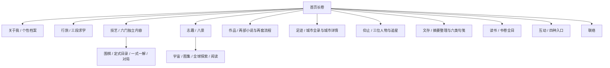

# 整站设计规划：东方写意水墨与书法墨韵

日期：2026-10-17

状态：设计规划与构图示意，尚未应用到现有网站。

基于当前 76 个公开及管理 HTML 页面梳理，包含 12 个首页部分、72 项细分设计。动态参数页的不同内容通过当前数据文件补充分析。

## 一、整体效果

保留《剑来》动画所启发的三维空间层次、写意水墨、文人风骨与克制剑气；融入留白、青绿、朱砂、卷轴叙事与书法墨韵。整站采用相同的视觉语言，每章按内容构图。

### 三处保留原本特色

物理与宇宙、剪视频、摄影的原有视觉效果、布局和功能优先保留。书墨仅协调题头、导航和外层衔接，内部特色不被整体风格覆盖。

### 整站画境

开篇、章节、详情与交互均延续留白、水墨、青绿、朱砂、卷轴和书墨；每章依内容改变构图、明暗与密度。

### 书墨层次

大题采用有笔锋的短题，章题使用宋体或行楷，小标题清楚收束；正文使用易读宋体，书法仅承担题签和短句。

### 东方哲思

通过动静、虚实、远近、人与天地的尺度传达气质；文字围绕现有真实内容，不额外添加玄虚论断。

### 卷轴的阅读

卷次与当前位置始终可知，目录能直达。首页以纵向移景连接各章，横向拖动只用于图集、时间线等明确区域。

### 图片的美感

封面、人物、棋谱、二维码与科学影像按用途展示；原图查看采用完整比例，装饰题图可按主体选择裁切。

### 动效的分寸

画境区有景深与慢雾，交互节点有短促剑意；长文、歌单、表单和棋谱操作区稳定，支持减少动态效果。

## 二、色彩与书墨

| 色彩 | 建议值 | 用途 |
|---|---|---|
| 宣白 | #F6F5EF | 大面积留白与正文纸面 |
| 墨青 | #1E302E | 正文、近景与深墨底 |
| 石青 | #456E79 | 远山、深空与辅助层次 |
| 石绿 | #647C65 | 青绿山体与主题小景 |
| 朱砂 | #A54134 | 当前节点、短线和小印 |
| 淡金 | #A18C5D | 少量光迹与细线 |

这些为本站拟定色彩，不是《剑来》官方色值。正文 16—18px、行高 1.8—2.0，文章版心约 32—36 个汉字；手机正文保持 16px 以上。题签可以短竖排，正文默认横排。

## 三、全站层级

## 四、十二部分与小章节设计

### 01 开篇 · 山水开卷

**气质：**远山有层次，近墨有锋芒。先进入画境，再认识站主。

**构图：**姓名与主句落在左侧大留白，右侧以青绿远山、墨色近峰形成斜向构图；一线淡金剑意穿过山隙，朱砂小印收住画面。导航在画境上沿保持轻巧。

**动态：**入场先显远山，再落姓名；近景、远景与雾层分别以极小幅度运动。首次向下滚动像沿山水长卷移景，随后恢复自然阅读。

**当前入口：**`index.html#top`

| 子章节 | 具体设计 |
|---|---|
| 姓名与主句 | 姓名为唯一主焦点，主句用短行宋体或行楷。首屏的背景诗句减少至一处，不与姓名争夺位置。 |
| 抽一诗笺 | 朱砂小印式入口，打开后是一张干净的笺纸；换句时短暂淡墨过渡，关闭后回到原来的位置。 |
| 全站目录 | 电脑用紧凑横向目录与卷次提示，手机用可展开目录。每个名称明确可点，页面当前位置以朱砂短线标记。 |

### 02 关于我 · 临窗小像

**气质：**清润、亲近，有书房的安静，也有个人的温度。

**构图：**首页采用留白中的一幅肖像与简短介绍，画像保留主体四周的呼吸空间，旁置短题款。独立自我介绍页采用人物小档、生活偏好、自述与相关入口的层次。

**动态：**肖像与文字分次轻入场；个性档案切换只移动细朱线，正文阅读时保持静止。

**当前入口：**`index.html#about`

| 子章节 | 具体设计 |
|---|---|
| 自我介绍 | 头像、姓名与短介绍构成清晰的页面开场；避免重复首页履历。所有字段保留真实填写状态。 |
| 星座与 MBTI | 星座用疏朗星点示意，MBTI 用四字母与短说明排版；不依据兴趣推测结果，未填写时只保留紧凑位置。 |
| 性格与偏好 | 性格轮廓、相处方式、日常作息、季节天气、色彩口味等分组排成细栏，不铺满大块资料卡。 |
| 自述 | 独立的一页纸式正文，字宽适中，留出段落间的呼吸；用户提供后再呈现具体文字。 |
| 兴趣、仰慕的人与追星 | 四组相关入口沿小目录排列，直接进入实际主题；仰慕的人与追星保持各自名称和层级。 |

### 03 行旅 · 求学山径

**气质：**一径通往远处，沿真实的求学阶段逐段展开。

**构图：**首页用贯穿三段的细墨山径连接初中、高中与大学，当前阶段稍突出。详情页按学校环境、个人记录与回望组织，三所学校在相同导航骨架下拥有不同的画面。

**动态：**读到某一阶段时，山径只亮出对应的一小段；照片按序出现，时间与学校信息始终稳定可读。

**当前入口：**`index.html#journey`

| 子章节 | 具体设计 |
|---|---|
| 昝岗二中 | 淡墨与浅绿为主，校园资料与初中阶段记录分开；先展示已经确认的学校信息。 |
| 唐河一高 | 墨色略沉，朱砂用于真实的重要时间；高中记录与照片按已提供的内容编排。 |
| 辽宁石油化工大学 | 青绿更开阔，当前阶段的学习、尝试与方向占主位；不编写尚未提供的大学经历。 |
| 重要时刻与阶段照片 | 重要时刻用边栏纪年，照片用有大小节奏的相册；缺少素材的栏目缩成短行，避免整屏空架。 |
| 行旅编辑页 | 延续纸墨色彩，表单保持常规清晰布局；编辑功能与公开叙事分开。 |

### 04 技艺 · 文心与手艺

**气质：**每门技艺有自己的器物、空间和阅读方式。

**构图：**首页保留文心、观物、清音的联系，用六幅不同构图的小景形成紧凑入口。进入后分别设计文稿、诗笺、影集、棋谱与曲目页面，版式随内容改变。

**动态：**写作以墨线引题，摄影以取景展开，围棋以真实落子推进，笛子和吉他用极轻的线条节奏。没有音频时不模拟播放器。

**当前入口：**`index.html#craft`

| 子章节 | 具体设计 |
|---|---|
| 写作 | 横向纸页与边批式札记；文章与手稿为主体，选题和修改记录作为可展开的附页。 |
| 作诗 | 短诗居于留白，题名、诗行与落款形成层次；长诗回到单栏阅读，炼字记录放入旁注。 |
| 摄影 | 保留现有摄影页面的视觉效果、布局、影像展示和功能。照片继续为主体，书墨仅协调外层题头与导航；不改成统一水墨画廊。 |
| 围棋总览 | 棋谱学习与对局棋盘分成明确的两个段落。小尺寸棋盘入口展示完整外形，打开后提供适应屏幕与放大视图。 |
| 循谱入局 · 定式目录 | 紧凑题头后立即见棋形；保留入门、进阶、复杂变化，名称与难度路径清楚。复杂型有独立入口，主型与变式归属可辨。 |
| 一式一解 · 讲解页 | 左侧保留 Word 式可检索棋谱目录，中间真实棋谱，正文按定式名称、形成过程、关键手段与结果、可能变式展开；窄屏目录收进抽屉。 |
| 十九路对局 | 棋盘线、交叉点、星位、坐标和中国规则以实际实现为准；全谱、逐手、悔棋与下载清楚可用。局部定式使用正确角部裁切。 |
| 笛子 | 竹影、浅青与长留白；按曲目、笛调、气息指法与真实练习记录排版。谱例与文字对齐，录音有实际文件再出现。 |
| 吉他 | 暖纸与墨弦，曲目与和弦、节拍示意形成横向关系；练习片段是短条目，与笛子的竹影长卷区别开。 |

### 05 志趣 · 八景入趣

**气质：**八个可以走进去的场景，保留物理与宇宙第二位。

**构图：**八项入口采用有疏密的图文排布，所有名称清楚可见。听歌偏清音书斋，宇宙偏深墨星河，游戏和动漫保留作品原有影像，各页共享页边、题款与导航语言。

**动态：**首页轻微景深，进入主题后动效随内容收敛；宇宙时间线单独承担空间运动，图集与长文浏览保持顺畅。

**当前入口：**`index.html#pastimes`

| 子章节 | 具体设计 |
|---|---|
| 听歌 | 以专辑书册、歌名行列与留白构成完整歌单；保留用户已经更新的全部内容，歌曲按已确认方式跳转对应页面。 |
| 周杰伦与 TFBOYS 歌单 | 歌单拥有独立分组和清楚的曲目索引，歌手、歌名、版本排列稳定；使用已确认的音源页面入口。 |
| 物理与宇宙 · 开场 | 从浅墨山影过渡到深空，真实宇宙影像为主；青绿与朱砂只用于界面与节点，不改变观测图像。 |
| 宇宙图集 | 沿用十类、561 幅的当前图库；类别像卷目，默认折叠，展开后分页浏览。图片显示名称与时间，完整图保留原比例。 |
| 全球宇宙探索 | 保留高级科技感与全球视野，将 23 个已有节点组织成可来回拖动的三维波形时间线：波形有真实透视、体积和前后遮挡，辅以精密年代刻度；书墨只融入题签和转场。 |
| 宇宙阅读与观测窗口 | 六章阅读按议题展开，观测设备以简洁图文条目呈现；科普文字、图像说明与装饰性意境分清。 |
| 游戏 · 目录与详情 | 手游、端游保持清楚分组；目录为封面图录，详情以该游戏真实画面为主，信息与个人记录各有位置。 |
| 动漫 · 图鉴与作品 | 目录以作品封面成册；详情保留作品一瞥、观影手记、片段与讨论。原作画面自然保留自身颜色。 |
| 动画专区与片段页 | 童年动画用更清亮的浅纸色；片段有画幅与文字注记，长列表分段加载。 |
| 剪视频 | 保留现有剪视频页面的视觉效果、布局与功能，延续镜头、剪辑节奏和影像质感。书墨仅协调题头、导航和章节衔接，不重排内部专门设计。 |
| 刷视频 | 精选条目配缩略图和短注，按已有收藏组织，保留明确跳转；少量留白防止信息拥挤。 |
| 阅读与旅游入口 | 阅读直接进入书卷全目，旅游进入足迹；保持单一内容归属，不另造重复页面。 |

### 06 作品 · 案头新卷

**气质：**作品是主角，书墨与光影衬托创作本身。

**构图：**首页保持完整一屏的章节感，以两部小说和两个创作流程形成紧凑的展陈。正在创作的夏天置前，封面完整保留，软件作品以横幅呈现；窄屏允许自然增高，避免内容裁切。

**动态：**像依次翻开案头作品，最多一次轻微展开；封面与人物图停留阅读时保持静止。

**当前入口：**`index.html#works`

| 子章节 | 具体设计 |
|---|---|
| 未寄出的夏天，只有风知道 | 浅青、夏日窗光与现代书桌，少量纸页意象。只展示封面、简短介绍和“创作中”，不额外透露人物关系与情节。 |
| 最后一封来自未来的信 | 深青夜色、星光与信纸并置；简介、人物、故事线索、意象分章，沿用已有介绍，不提供小说全文。 |
| 人物介绍 | 人物图片保留完整面部与主要姿态，文字说明邻侧排列；不同人物有轻微色温差异，避免同一框裁掉头部。 |
| 文字成像 · SD-WebUI | 青绿墨迹与真实生成示例并置，流程步骤紧凑排列；图片与视频工作流作为该软件下的栏目。 |
| 节点绘图 · Z-Image | 深浅墨线组织节点关系，参数、输入输出和结果各有清楚位置；视频工作流只有真实文件存在时才展示。 |

### 07 足迹 · 山河行记

**气质：**地图是索引，真实城市照片展开每一段行程。

**构图：**首页用淡墨地图与少量城市影像相互配合；城市全录紧凑列出，到城市页后以对应地标图作题头。风景照片保持清晰，游记回到纸面阅读。

**动态：**选中城市时朱砂点与地名响应，进入详情后地标画面轻缓展开。地图可用列表替代浏览，避免必须精准点小点。

**当前入口：**`index.html#travels`

| 子章节 | 具体设计 |
|---|---|
| 城市全录 | 统一使用“足迹”的命名；省份、城市与到访时间是清楚的目录层级，按真实记录展示。 |
| 城市题头 | 每个城市使用相应地标图片，标题区域留出安全位置；图像主体和文字不重叠。 |
| 何时来过与所到之处 | 多次到访按时间展开，地点采用紧凑条目；不把资料图片当作用户实拍。 |
| 途中影像、行中手记、风物滋味 | 影像按比例排，手记单栏读，风物用短条目；尚未提供的内容压缩收起。 |
| 河南十八城 | 以河南地图与城市卷目形成专题，地标影像和文字沿省域主题展开，避免与求学行旅混名。 |
| 影像来源页 | 来源信息集中、可查；公开游览页的图像身份与必要署名保持准确。 |

### 08 仰止 · 人物立卷

**气质：**因人设境，人物的作品与精神各自成章。

**构图：**首页前三位人物为主要立卷，头像与姓名清楚；追星以较轻的第二行进入。详情页采用各自的内容组织和画面气质，长诗与文章保留清晰的阅读面。

**动态：**人物题款短暂显现，进入诗文后以静为主；专辑和棋谱使用各自所需的交互。

**当前入口：**`index.html#admire`

| 子章节 | 具体设计 |
|---|---|
| 毛泽东 | 沉稳墨色与克制朱砂，精神、诗词、文章、书法分章；历史图片保持真实，对精神内容不做无依据的改写。 |
| 屈原 | 深青、江水与香草意象，楚辞节选与阅读线索结合，篇名和正文形成清楚层级。 |
| 李白 | 开阔留白、淡墨远山与江流，诗歌可按现有主题展开；题名有笔意，诗文清楚横排。 |
| 柯洁 | 黑白、棋形与真实对局作主视觉，代表比赛、棋谱与复盘构成页面，避免套用人物生平模板。 |
| 周杰伦 | 墨青与暖色唱片意象，按专辑、EP、代表作品与完整歌单编排，相关音乐入口直接可用。 |
| TFBOYS | 清亮青绿与三人组合影像，组合音乐、成员与作品各有独立位置，清楚关联现有歌单。 |

### 09 文存 · 墨迹成笺

**气质：**书墨最明显的一章，让文字有分量，让纸面能安静下来。

**构图：**首页用三篇选读与一张句笺形成主次，篇目标题保留实际内容。目录用纸面行列和分类索引，详情专注阅读；句笺用疏朗句读和主题分卷。

**动态：**翻篇只在目录切换与抽笺时出现；复制、搜索与定位反馈清楚。长文与句笺正文不持续漂浮。

**当前入口：**`index.html#writing`

| 子章节 | 具体设计 |
|---|---|
| 摘要与整理 · 目录 | 按现有的人生取舍、处世分寸、自处成长、关系相处与得失遗憾组织。首页顺序单独配置，不把技巧类旧内容重新放回。 |
| 文章阅读页 | 题目、短引言、正文和相邻篇目组成单栏阅读，宽度约 32—36 个汉字；具体情境与辨析保留，不新增假大空的格言段。 |
| 句笺 · 主题目录 | 六类持续保留，各主题用不同的淡墨纹理与一小处色彩区别；搜索、复制与主题定位保持便捷。 |
| 少年志气 | 青绿远峰与向上笔势，选句排得疏朗、有精神。 |
| 迎难向前 | 近处较浓的墨山与远处一道光，容纳坚韧和把困境看作短暂挫折的表达。 |
| 勤学笃行 | 细墨行格与朱笔小记，保持清晰的逐句阅读。 |
| 豁达自持 | 平远水面与大片留白，长句按语意分行。 |
| 释怀新生 | 由墨到浅青的层次，翻笺轻缓，保留自我和解的选句。 |
| 人间温柔 | 暖白纸色与一枝淡墨，文字温和，避免大面积粉色与装饰花边。 |
| 前台信息范围 | 依照既有要求展示摘要、整理与句子；作者书名、来源网站及内部选材记录不重新加入此章前台。后台核对资料继续保留。 |

### 10 读书 · 书斋藏卷

**气质：**有书架的秩序，也有翻阅时的轻松。

**构图：**首页六种书影在矮书架式构图中完整出现，旁边留一列卷目；全目录按封面与书目信息排布，封面比例各自保留。

**动态：**悬停或键盘聚焦时书影轻抬，点开后清楚显示书籍信息与已有跳转；不自动翻动全部封面。

**当前入口：**`index.html#reading`

| 子章节 | 具体设计 |
|---|---|
| 首页书影 | 六册预览有大小节奏和统一基线，完整展示书名，不强行裁成同一画幅。 |
| 书卷全目 | 现有 39 册书目继续保留，封面、书名、简介与阅读入口清楚排列；搜索与类别随实际功能设置。 |
| 书目信息与文存关联 | 书籍资料留在读书区，相关摘要与整理通过内容链接关联，避免在文存前台重复来源信息。 |

### 11 互动 · 亭中题字

**气质：**像在亭中留一行字，清楚、安静、容易回应。

**构图：**题壁、尺素、结盟、题跋四个入口保持明确名称，用四种纸面构图区别。输入区是清晰的横排表单，留言区是可阅读的纸页条目。

**动态：**提交成功后出现简短朱印反馈，同时给出文字状态；错误时保留已输入内容，不做整页动画。

**当前入口：**`index.html#links`

| 子章节 | 具体设计 |
|---|---|
| 题壁 | 公开留言以短笺排列，时间与回复关系容易辨认，长内容可展开。 |
| 尺素 | 信纸式单栏写信，公开与私密说明靠近操作区，沿用现有权限规则与提交方式。 |
| 结盟 | 以站点名片与简介构成小册，链接可点、状态清楚，保持真实申请流程。 |
| 题跋 | 围绕文章或作品的评论按上下文组织，长评重阅读，不堆成一墙小卡片。 |
| 站主信箱 | 沿用身份验证与消息管理，功能控件清楚、密度适中；只使用轻量纸墨界面。 |

### 12 联络 · 合卷留白

**气质：**一卷收束，留一个可以再来的入口。

**构图：**以宽阔留白、一小段正式介绍和现有联络方式收尾。二维码完整显示，四周留干净边界；回到开篇用一条短墨线衔接。

**动态：**进入结尾时淡墨收拢一次，二维码与联络文字静止。复制后有明确文字提示。

**当前入口：**`index.html#contact`

| 子章节 | 具体设计 |
|---|---|
| 联络方式 | 保留实际提供的邮箱、账号与链接；清理编辑提示，文案只陈述已确认的信息。 |
| 二维码与账号 | 原始二维码保留完整比例和白边，不重绘、不加水墨滤镜；点击、复制与识别都有清楚入口。 |
| 页脚与返回 | 页脚使用小号可读字，回到顶部的按钮不遮挡内容，手机端留出安全距离。 |

## 五、不同页面的结构

| 页面用途 | 结构 |
|---|---|
| 首页章节 | 开场景别 + 轻目录 + 精选内容 + 清楚的深入入口 |
| 内容目录 | 紧凑题头 + 主题索引 / 搜索 + 可浏览的真实条目 |
| 长篇阅读 | 题名 + 短引 + 单栏正文 + 可收起目录 + 相邻篇目 |
| 图像作品 | 图像主体 + 短说明 + 原比例查看 + 按需展开 |
| 棋谱工具 | 棋谱目录 + 真实棋形 + 逐手控制 + 解释与变式 |
| 互动表单 | 正式说明 + 标注字段 + 提交反馈 + 内容列表 |
| 管理编辑 | 轻量纸墨色 + 明确控件 + 已有身份验证和数据操作 |

## 六、动效与手机规则

- 画境入场约 0.8—1.2 秒，标题显现约 0.5—0.8 秒；操作反馈约 0.18—0.3 秒。参数在实际浏览中调整。
- 一页最多一处持续三维场景；离开视口或浏览器隐藏时暂停。慢雾仅用少量分层位移。
- 剑气用于开场和重大节点反馈；阅读区与输入区不常驻闪动，不自动播放音乐或视频。
- 首页保留章节导航，滚动自然；横向拖动限制在明确可交互的长卷区域。键盘和按钮也能完成相同操作。
- 手机将多栏收成单栏，长目录收进抽屉，棋盘先完整适屏，图集先折叠。所有重要操作区域至少 44×44px。
- 开启减少动态效果后展示静态构图，所有导航、棋谱和内容仍可操作。
- 桌面章节具有一屏的完整构图；内容增长或窄屏时自然增高，避免“只有半截”。

## 七、素材与内容边界

- 用户已明确：物理与宇宙、剪视频、摄影保留原有视觉效果、布局与功能。书墨只协调外层题头、导航与章节衔接；内部专门设计不统一重做。
- 用户已经更新的音乐、作品、个人资料、路线和已有链接继续保留。
- 自述、星座、MBTI 与经历不推测填充。未寄出的夏天仅作简短介绍并标创作中，小说不展示全文。
- 科学图片、历史与现代人物照片、作品封面保留内容身份与必要真实性，不加损害辨识的水墨滤镜。
- 围棋手顺、角部边线、星位、逐手提子与中国规则单独验收；内容数量不以镜像或重复变式凑数。
- NASA 小图源入口与图像日期类型继续保留；全球探索事件不局限于 NASA。
- 二维码沿用原始文件与安全留白，不能重绘。

## 八、实施顺序

### 第一阶段 · 建立全站画境

确定书墨字体、纸墨青绿与朱砂的关系，统一导航、卷次、页边与图片规则；完成首页十二部分的实际构图。

### 第二阶段 · 深入内容页

分别处理自我介绍、三段求学、六门技艺、八项志趣、四项作品、城市、六个人物、文存与书架。

### 第三阶段 · 重点交互

专门完成一式一解与棋谱目录、十九路棋盘、宇宙长卷、折叠图集、句笺、歌单与留言反馈。

### 第四阶段 · 整站验收

逐页检查电脑和手机的布局、导航、图像裁切、阅读、加载和减少动态；对生成脚本同步修改，避免重建覆盖。

## 九、验收标准

1. 首页、主题页和详情页均能看出同一套纸墨、书法和东方写意语言。
2. 六门技艺、八项志趣、各个人物、两部小说的页面结构由内容决定。
3. 所有入口能打开对应内容，手机目录和返回路径完整。
4. 图片没有不合适裁切、拉伸、挤压；封面、人物与二维码各按用途呈现。
5. 棋谱、图库、歌单、搜索、复制和留言不因视觉改造失效。
6. 390px、768px 与 1440px 下无横向溢出和按钮遮挡；长文与正文可读。
7. 生成脚本与页面同步，重建后保留新设计。
8. 设计预览和实际实现分别标明状态，未完成的部分不宣称已落地。

## 附：当前页面清单

| 路径 | 当前标题 |
|---|---|
| about/index.html | 自我介绍 · Cheney |
| books.html | 书卷全目 · Cheney |
| craft/dizi.html | 笛子 · Cheney |
| craft/go.html | 围棋 · Cheney |
| craft/guitar.html | 吉他 · Cheney |
| craft/joseki-detail.html | 定式讲解 · 围棋 · Cheney |
| craft/joseki.html | 定式棋谱目录 · 围棋 · Cheney |
| craft/photography.html | 摄影 · Cheney |
| craft/poetry.html | 作诗 · Cheney |
| craft/writing.html | 写作 · Cheney |
| figures/jay.html | 周杰伦 · 追星 · Cheney |
| figures/ke.html | 柯洁 · 追星 · Cheney |
| figures/li.html | 李白 · 人物 · Cheney |
| figures/mao.html | 毛泽东 · 人物 · Cheney |
| figures/qu.html | 屈原 · 人物 · Cheney |
| figures/tfboys.html | TFBOYS · 追星 · Cheney |
| henan.html | 河南十八城 · Cheney |
| index.html | Cheney · 个人主页 |
| interaction/ally.html | 结盟 · 互动 · Cheney |
| interaction/featured.html | 题跋 · 互动 · Cheney |
| interaction/letter.html | 尺素 · 互动 · Cheney |
| interaction/owner.html | 站主信箱 · Cheney |
| interaction/wall.html | 题壁 · 互动 · Cheney |
| journey/edit.html | 整理行旅 · Cheney |
| journey/junior.html | 昝岗二中 · 行旅 · Cheney |
| journey/senior.html | 唐河一高 · 行旅 · Cheney |
| journey/university.html | 辽宁石油化工大学 · 行旅 · Cheney |
| pastimes/animation.html | 动画专区 · Cheney |
| pastimes/anime-scene.html | 动漫观影笔记 · Cheney |
| pastimes/anime-work.html | 作品小档 · Cheney |
| pastimes/anime.html | 动漫图鉴 · Cheney |
| pastimes/detail.html | 志趣 · Cheney |
| pastimes/game.html | 游戏 · Cheney |
| pastimes/games.html | 游戏图鉴 · 志趣 · Cheney |
| pastimes/physics.html | 物理与宇宙 · 志趣 · Cheney |
| travels/city.html | 城市足迹 · Cheney |
| travels/credits.html | 足迹影像来源 · Cheney |
| travels/index.html | 行旅全录 · Cheney |
| works/future-letter/index.html | 最后一封来自未来的信 · 作品 · Cheney |
| works/sd-webui/index.html | 文字成像 · SD-WebUI · 光影工坊 · Cheney |
| works/unsent-summer/index.html | 未寄出的夏天，只有风知道 · 作品 · Cheney |
| works/z-image/index.html | 节点绘图 · Z-Image · 光影工坊 · Cheney |
| writing/ask-for-specific-feedback.html | 怎样面对暂时无法改变的现实 · 文存 · Cheney |
| writing/ask-the-right-question.html | 如何面对熟悉生活的变化 · 文存 · Cheney |
| writing/ask-with-context.html | 怎样面对善意比较带来的压力 · 文存 · Cheney |
| writing/choose-learning-material.html | 如何看待稳定与冒险的取舍 · 文存 · Cheney |
| writing/compare-before-choosing.html | 如何看待一个人的缺点与长处 · 文存 · Cheney |
| writing/compare-similar-concepts.html | 怎样辨别自己的愿望与旁人的期待 · 文存 · Cheney |
| writing/compare-your-own-progress.html | 怎样看待被拒绝这件事 · 文存 · Cheney |
| writing/confidence-by-doing.html | 怎样看待旧经验与新的生活 · 文存 · Cheney |
| writing/confirm-an-agreement.html | 怎样理解接受帮助与保持独立 · 文存 · Cheney |
| writing/define-finished.html | 怎样接受关系渐行渐远 · 文存 · Cheney |
| writing/edit-next-day.html | 如何面对不被理解的选择 · 文存 · Cheney |
| writing/find-the-sentence.html | 怎样看待过去做错的决定 · 文存 · Cheney |
| writing/give-information-an-output.html | 如何面对暂时没有答案的问题 · 文存 · Cheney |
| writing/index.html | 文存 · Cheney |
| writing/leave-room-in-a-plan.html | 如何面对得不到认可的付出 · 文存 · Cheney |
| writing/lines.html | 句笺 · 文存 · Cheney |
| writing/listen-before-advising.html | 如何对待承诺落空后的失望 · 文存 · Cheney |
| writing/make-a-small-thing.html | 怎样对待与自己意见不同的人 · 文存 · Cheney |
| writing/make-an-example.html | 如何理解普通生活的价值 · 文存 · Cheney |
| writing/pause-before-replying.html | 如何面对得失中的不确定 · 文存 · Cheney |
| writing/read-with-time.html | 如何理解亲近关系中的差异 · 文存 · Cheney |
| writing/say-no-with-a-boundary.html | 如何在责任与自我之间作取舍 · 文存 · Cheney |
| writing/science-and-creation.html | 如何面对关系中的人情与亏欠 · 文存 · Cheney |
| writing/search-a-narrow-question.html | 怎样决定一件事还值不值得坚持 · 文存 · Cheney |
| writing/separate-what-you-control.html | 怎样理解知足与不甘心 · 文存 · Cheney |
| writing/short-by-thinking.html | 如何理解自信与承认不足 · 文存 · Cheney |
| writing/shrink-the-next-step.html | 如何看待独处与合群 · 文存 · Cheney |
| writing/slow-is-forward.html | 怎样看待错过与遗憾 · 文存 · Cheney |
| writing/spaced-review.html | 如何面对人生进度的不同 · 文存 · Cheney |
| writing/stop-one-thing-first.html | 怎样理解有分寸的善良 · 文存 · Cheney |
| writing/test-an-explanation.html | 怎样在利益面前守住分寸 · 文存 · Cheney |
| writing/trace-original-information.html | 怎样判断善意有没有越过边界 · 文存 · Cheney |
| writing/try-before-committing.html | 如何理解体谅与责任的关系 · 文存 · Cheney |
| writing/write-to-think.html | 怎样看待努力与结果之间的落差 · 文存 · Cheney |
